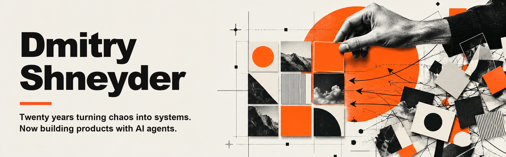
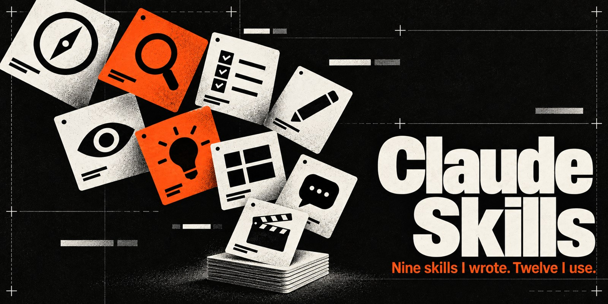
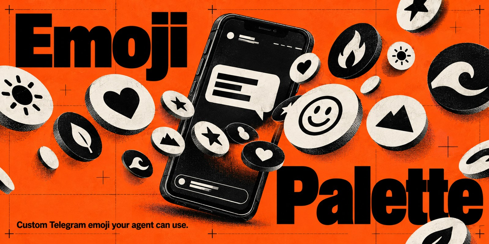

<a href="https://t.me/dshneyder"></a>

<a href="https://t.me/dshneyder"></a>

I am a product person, not a developer. For twenty years my work has been people: psychology, training, teams. For the last year I have been building products with AI agents, and I do not write the code by hand. This account holds the parts of that work anyone can pick up and use.

## my-claude-skills

<a href="https://github.com/GuruDevvv/my-claude-skills"></a>

Nine skills I wrote for Claude Code and twelve third-party ones I use, kept in one place so the setup can be rebuilt on another machine.

**Why it exists.** When you do not write the code, what you control is how the work is set up before the agent starts: a spec, a check that the thing is worth building, a design picked from options, a review before any code exists. Each skill is one of those steps, written down once so I stop explaining it in every session.

**What it is.** Folders of instructions, some with scripts. Mine and third-party live in separate folders. The third-party ones are MIT, each with its author, source and licence text; two were broken on Windows and are patched, and each patch is described at the top of that skill's README.

<a href="https://github.com/GuruDevvv/my-claude-skills"></a>

Install: copy a skill's folder into `~/.claude/skills/<skill-name>/` and restart Claude Code.

## design-first

<a href="https://github.com/GuruDevvv/my-claude-skills/tree/main/mine/design-first"></a>

A Claude Code skill for people who are not designers: six different first screens for your topic, you pick one, and it is built as a live page for desktop and phone.

**Why it exists.** "Make it look good" is not a brief. Ask an agent for a page and you get the same clean modern layout every time. Choosing between six is easier than describing one.

**What it is.** One of the skills in the collection above. An image model draws six first-screen mockups, you pick one or mix two, the text is taken off the chosen mockup and the page is built with live text over it; the phone gets its own mockup. Before you see the page, a script opens it in a real browser at three widths and checks sideways scroll, unreadable text, missing fonts and broken images. It needs Node 22+, Chrome or Edge, and an image generator such as the Codex CLI.

<a href="https://github.com/GuruDevvv/my-claude-skills/tree/main/mine/design-first"></a>

Install: copy `mine/design-first/` from the collection into `~/.claude/skills/design-first/` and restart Claude Code.

## emoji-palette-kit

<a href="https://github.com/GuruDevvv/emoji-palette-kit"></a>

A curated palette of Telegram custom emoji for an AI agent: you choose which emoji it may use, a vision model writes down what each one means.

**Why it exists.** A custom emoji has no text name, only an ID, so an agent cannot type one. The built-in alias is no help either: the emoji filed under 🙏 may turn out to be a sitting Buddha.

**What it is.** One Python file with the HTML interface inside it. You switch emoji on in the browser, the script has a vision model describe each one, and the result is a JSON palette. The agent writes `:key:` in its text and the emoji is put in by ID before sending. The documentation is in Russian.

<a href="https://github.com/GuruDevvv/emoji-palette-kit"></a>

Install:

```bash
curl -O https://raw.githubusercontent.com/GuruDevvv/emoji-palette-kit/main/emoji_palette_kit.py
pip install telethon
python emoji_palette_kit.py init
```

## How the work is checked

None of these has an automated test suite of its own. What they have instead:

- **design-first** checks its own output. The page checker ships with control pages: four broken on purpose and two clean, with the expected verdict for each, so a green result means something. The switch to drawn mockups came out of seven blind rounds in September 2026: every screen I called a "wow" was drawn by an image model, none was written as HTML. The protocol is summarised inside the skill.
- **my-claude-skills** ships the research two of its skills came out of, next to the skill. One good third-party skill is left out on purpose: its repository has no licence file, so redistributing it would not be legal.
- **emoji-palette-kit** describes animated emoji from a still frame, so the meaning of the movement can be lost. Its README says so and asks you to check those by hand.

## Who writes the code

My part is the task, the decisions, and accepting or rejecting the result. The code and most of the text in these repositories are written by AI agents: Claude Code does the work, and Codex is the second opinion and draws the pictures on this page.

The histories show it: as of 11 October 2026, 60 of the 68 public commits across the two repositories carry a `Co-Authored-By: Claude` trailer.
